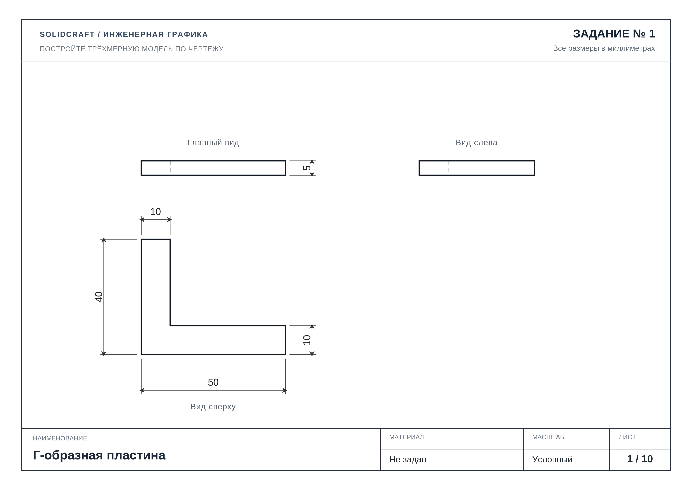
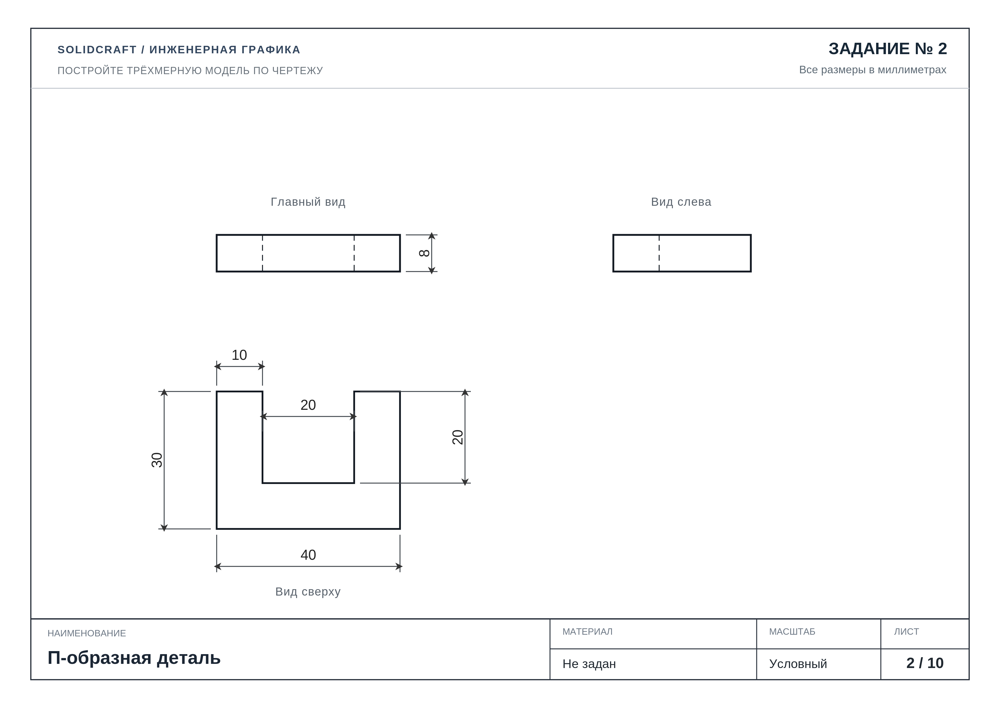
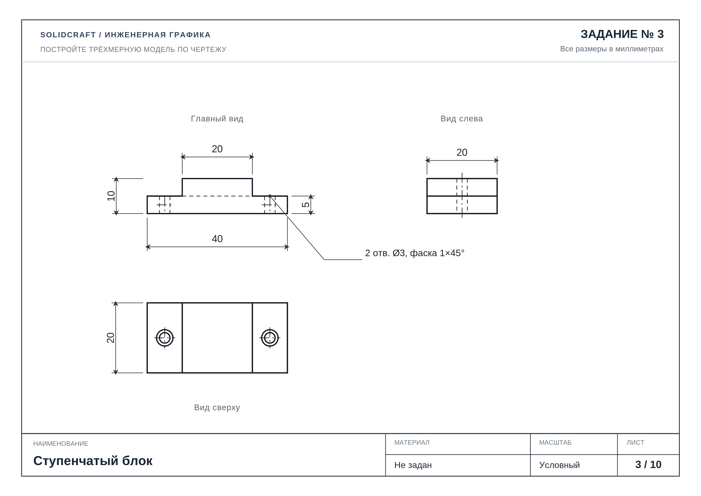
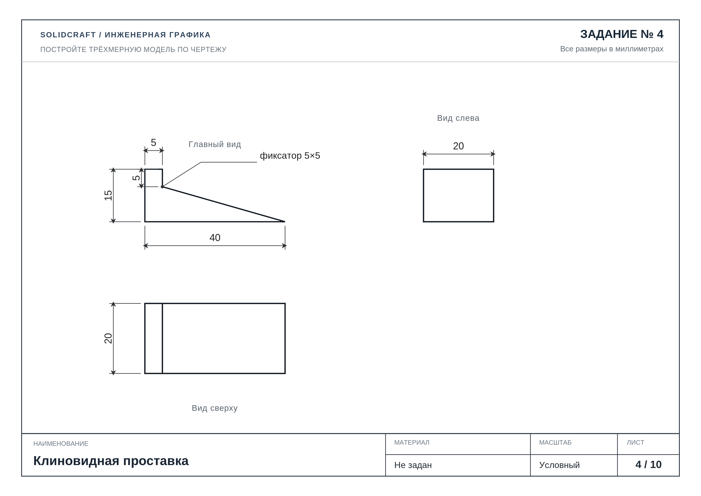
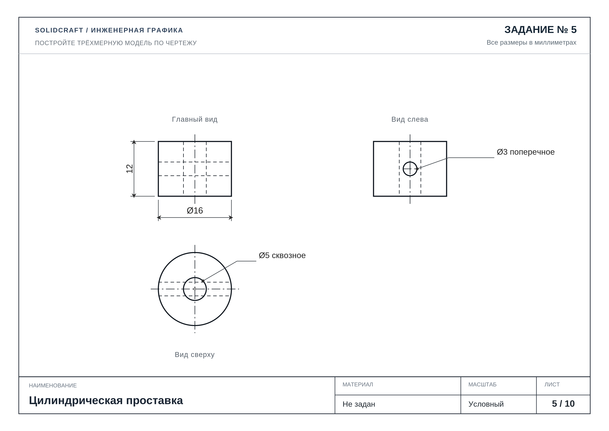
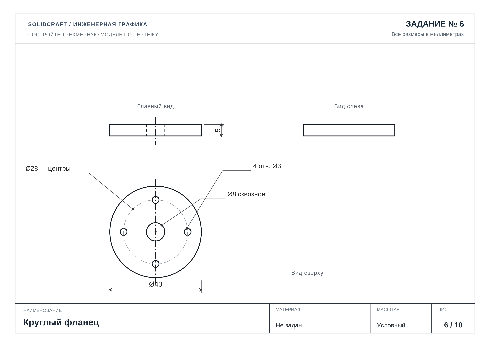
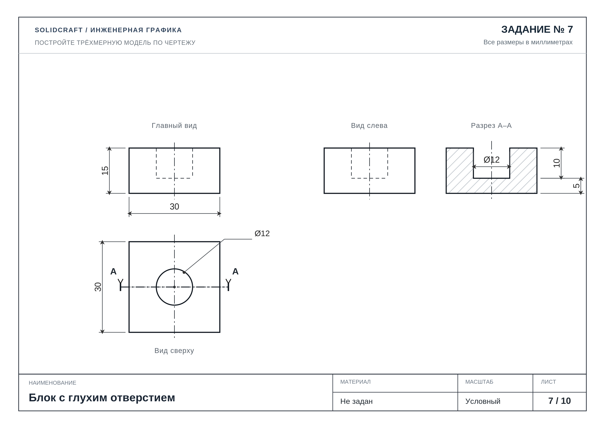
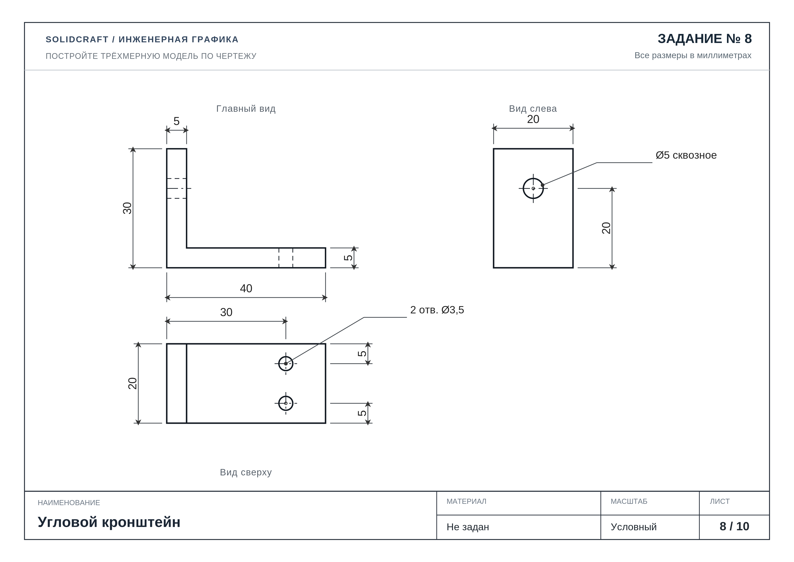
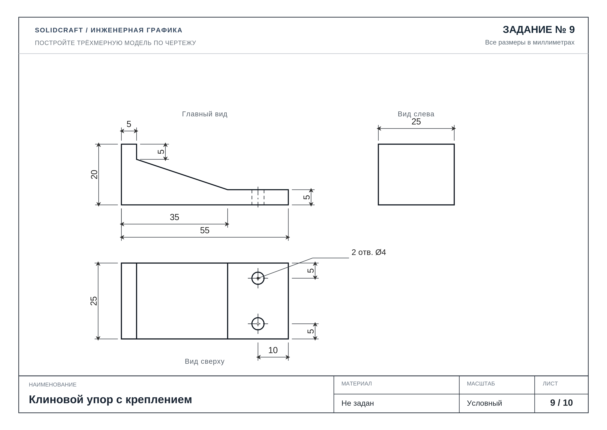
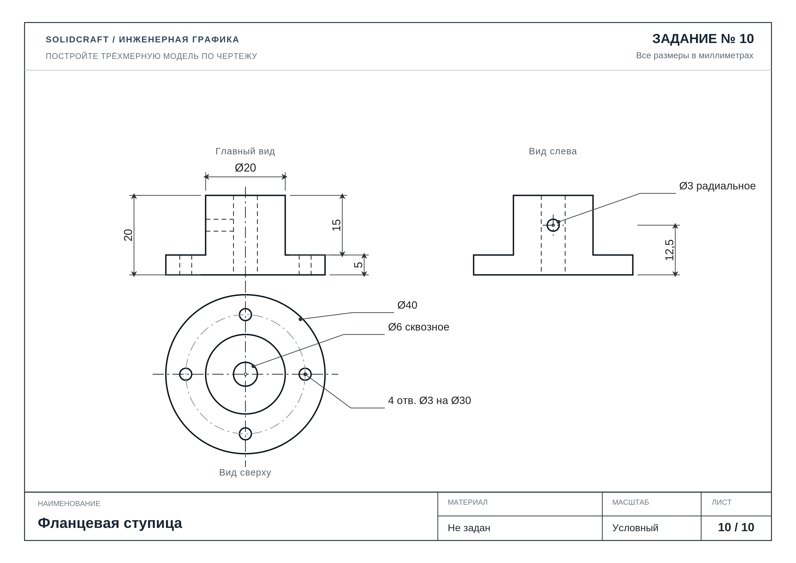

# SolidCraft · Инженерная графика

**10 учебных чертежей для самостоятельного построения 3D-моделей.**

Практикум по чтению ортогональных проекций и моделированию деталей для робототехники. Задания 1–7 знакомят с основными приёмами, задания 8–10 **комбинируют изученные операции**. Для решения подойдёт SolidCraft или любая параметрическая CAD-система.

## Быстрый переход к заданиям

| № | Деталь | Чертёж PNG |
|:--:|---|---|
| 1 | [Г-образная пластина](#задание-1-г-образная-пластина) | [Открыть / скачать](PNG/01_l_plate.png) |
| 2 | [П-образная деталь](#задание-2-п-образная-деталь) | [Открыть / скачать](PNG/02_u_plate.png) |
| 3 | [Ступенчатый блок](#задание-3-ступенчатый-блок) | [Открыть / скачать](PNG/03_step.png) |
| 4 | [Клиновидная проставка](#задание-4-клиновидная-проставка) | [Открыть / скачать](PNG/04_wedge.png) |
| 5 | [Цилиндрическая проставка](#задание-5-цилиндрическая-проставка) | [Открыть / скачать](PNG/05_sleeve.png) |
| 6 | [Круглый фланец](#задание-6-круглый-фланец) | [Открыть / скачать](PNG/06_flange.png) |
| 7 | [Блок с глухим отверстием](#задание-7-блок-с-глухим-отверстием) | [Открыть / скачать](PNG/07_blind.png) |
| 8 | [Угловой кронштейн](#задание-8-угловой-кронштейн) | [Открыть / скачать](PNG/08_angle_bracket.png) |
| 9 | [Клиновой упор с креплением](#задание-9-клиновой-упор-с-креплением) | [Открыть / скачать](PNG/09_wedge_stop.png) |
| 10 | [Фланцевая ступица](#задание-10-фланцевая-ступица) | [Открыть / скачать](PNG/10_flanged_hub.png) |

## Смотреть, скачать или распечатать

- **Просмотр:** прокрутите эту страницу — все чертежи доступны ниже. Нажмите на изображение, чтобы открыть оригинал.
- **Один PNG:** откройте его из таблицы и скачайте кнопкой **Download raw file** на GitHub.
- **Все задания:** нажмите на главной странице репозитория **Code → Download ZIP**. Изображения находятся в `PNG/`.
- **Печать:** откройте PNG на компьютере и выберите **A4, альбомная ориентация, вписать в страницу**.
- **Интерактивная версия:** загрузите файл `index.html` на компьютер и откройте браузером. Он позволяет листать чертежи, сохранять текущий лист в PNG и печатать его. Если включить GitHub Pages для этого репозитория, тот же интерфейс будет доступен как сайт.

Чертежи выполнены в миллиметрах. Размер каждого PNG: **3600 × 2550 пикселей**. Масштаб на листах условный; при моделировании используйте указанные размеры.

---

## Задание 1. Г-образная пластина

Плоская Г-образная деталь 50 × 40 × 5 мм, ширина полок 10 мм.

**Тренируем:** Замкнутый эскиз, выдавливание.

[**Открыть чертёж в полном размере / скачать PNG**](PNG/01_l_plate.png)

## Задание 2. П-образная деталь

Плоская деталь 40 × 30 × 8 мм, П-образный вырез 20 × 20 мм.

**Тренируем:** Контур с внутренним вырезом.

[**Открыть чертёж в полном размере / скачать PNG**](PNG/02_u_plate.png)

## Задание 3. Ступенчатый блок

Основание 40 × 20 × 5 мм, ступень 20 × 20 × 5 мм, два отверстия Ø3 мм с фаской 1 × 45°.

**Тренируем:** Два уровня, сквозные отверстия и фаски.

[**Открыть чертёж в полном размере / скачать PNG**](PNG/03_step.png)

## Задание 4. Клиновидная проставка

Клин 40 × 20 × 15 мм с уступом-фиксатором 5 × 5 мм.

**Тренируем:** Наклонная грань и ступень-фиксатор.

[**Открыть чертёж в полном размере / скачать PNG**](PNG/04_wedge.png)

## Задание 5. Цилиндрическая проставка

Втулка Ø16 мм, высота 12 мм, осевое отверстие Ø5 мм, поперечное Ø3 мм.

**Тренируем:** Цилиндр, осевое и поперечное отверстия.

[**Открыть чертёж в полном размере / скачать PNG**](PNG/05_sleeve.png)

## Задание 6. Круглый фланец

Фланец Ø40 × 5 мм, осевое Ø8 мм, четыре отверстия Ø3 мм на окружности Ø28 мм.

**Тренируем:** Круговой массив и соосные элементы.

[**Открыть чертёж в полном размере / скачать PNG**](PNG/06_flange.png)

## Задание 7. Блок с глухим отверстием

Блок 30 × 30 × 15 мм, глухое отверстие Ø12 мм глубиной 10 мм, разрез А–А.

**Тренируем:** Глухое выдавливание-вырезание и чтение разреза.

[**Открыть чертёж в полном размере / скачать PNG**](PNG/07_blind.png)

## Задание 8. Угловой кронштейн

40 × 20 × 30 мм, стенки 5 мм, два отверстия Ø3,5 мм в основании и Ø5 мм в вертикальной стенке.

**Тренируем:** Г-образное выдавливание + отверстия на двух перпендикулярных гранях.

[**Открыть чертёж в полном размере / скачать PNG**](PNG/08_angle_bracket.png)

## Задание 9. Клиновой упор с креплением

Основание 55 × 25 × 5 мм, клин до общей высоты 20 мм, фиксатор 5 × 5 мм, два отверстия Ø4 мм.

**Тренируем:** Наклон + фиксатор + отдельные отверстия в монтажной площадке.

[**Открыть чертёж в полном размере / скачать PNG**](PNG/09_wedge_stop.png)

## Задание 10. Фланцевая ступица

Фланец Ø40 × 5 мм, бобышка Ø20 × 15 мм, осевое Ø6 мм, 4 × Ø3 на Ø30 мм, радиальное Ø3 мм.

**Тренируем:** Соосные выдавливания + круговой массив + радиальное сверление.

[**Открыть чертёж в полном размере / скачать PNG**](PNG/10_flanged_hub.png)

---

*Независимый учебный практикум по инженерной графике и 3D-моделированию.*
